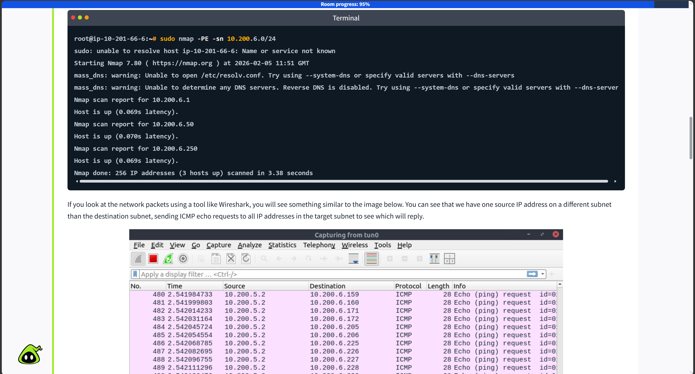

# Lab: Active Network Mapping & Host Discovery with Nmap

## 1. Objective
Performed active network mapping to discover live assets on a target subnet across different network layers using specialized Nmap flags.

## 2. Comprehensive Fleet of Commands Practiced

### Baseline Layer-by-Layer Discovery
```bash
# Data Link Layer: Immediate local street discovery (Fastest, unblockable by host firewalls)
sudo nmap -PR -sn <target_ip_or_subnet/24>

# Network Layer: Standard cross-router discovery (Prone to standard firewall drops)
nmap -PE -sn <target_ip_or_subnet/24>

# Transport Layer: Standard connection initiation (Forces active hosts to respond)
nmap -PS -sn <target_ip_or_subnet/24>
```

### Advanced Firewall Evasion & Trick Probes
```bash
# ICMP Timestamp Probe: Sneaks past firewalls that only block standard echo requests
nmap -PP -sn <target_ip_or_subnet/24>

# ICMP Address Mask Probe: Alternative logic query to bypass lazy border guards
nmap -PM -sn <target_ip_or_subnet/24>

# TCP ACK Gaslight Scan: Fires mid-conversation packets out of nowhere to force a state reset (RST)
sudo nmap -PA -sn <target_ip_or_subnet/24>

# UDP Closed-Door Fishing: Targets random high ports to force an ICMP Port Unreachable error response
sudo nmap -PU -sn <target_ip_or_subnet/24>
```

### Target Selection Shorthands & Optimization
```bash
# Space-Separated List: Scanning completely different assets simultaneously
nmap <machine_ip> scanme.nmap.org example.com

# Range/Dash Method: Mass scanning a specific block of consecutive rooms
nmap 10.10.0-255.101-125

# Comma Method: Scanning exact target positions while skipping everything in between
nmap 192.168.1,2.50-51

# Input List File: Feeding massive lists of pre-discovered enterprise assets into a scan
nmap -iL my_targets.txt
```

### Recon Stealth, Reverse-DNS & Speed Tools
```bash
# List Scan (Sneak Peek): Maps out target labels strictly via DNS without hitting active hosts
nmap -sL <target_subnet>

# Stealth/Speed Optimization: Force disables Reverse-DNS lookups to prevent logging paper trails
nmap -sn -n <target_ip_or_subnet/24>

# Reverse-DNS Enforcement: Forces a reverse lookup on every host slot to scrape internal names
nmap -sn -R <target_ip_or_subnet/24>

# Masscan High-Velocity Deploy: Internet-scale rapid scan engine for mass port targeting
masscan <target_subnet> -p80,443
```

## 3. Core Architectural Rules Mastered
* **The Gated Block Rule:** CIDR notations lock down specific binary network boundaries (e.g., `/29` splits the subnet into blocks of 8 numbers, resetting Nmap's starting search floor automatically).
* **The Multiplier Rule:** Using multiple dash/comma ranges creates a massive target matrix where total scanned slots equal the combination count multiplied together (e.g., `256 x 25 = 6400`).
* **The Permission Divide:** Privileged scans (`sudo`) can craft raw, custom network packets to drop connections instantly (`RST`). Unprivileged accounts are legally restricted by the OS to standard, polite TCP 3-Way Handshakes.

## 4. Practical Verification Proof
Below is the verification showing successful host discovery and packet responses on the live target environment:


